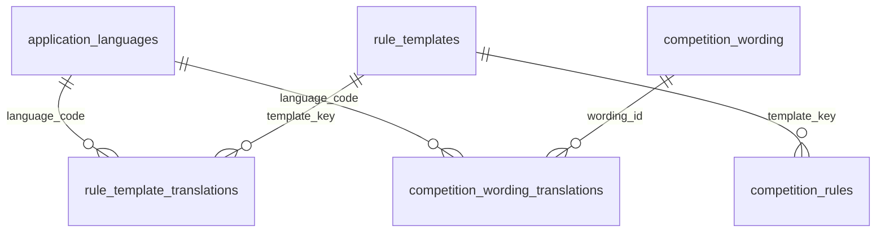

# Translations

`core/i18n/language.config.ts` defines bundled interface languages (`Language` enum),
`DEFAULT_LANGUAGE`, storage key, dictionary mappings and flags. The database's
`application_languages` table is the runtime language registry. Admin → Settings →
Languages and content manages this registry across all competitions. English is
the required fallback; disabling another language preserves its translations.

English is the default. `TranslationService` owns the selected language code
and saves it in localStorage under `predictor26.language`. This preference
belongs to the browser, is shared by accounts using that browser, and survives
logout. It is not synchronized between devices. Blocked storage does not prevent
switching languages for the current page session.

The sidebar header contains the shared `LanguageSwitcherComponent`. Its flag
buttons show the active language and update translations without reloading.
Flag paths are configured in `language.config.ts` and point to `public/flags`.
Translated language names remain in button titles and accessibility labels.

## Loading

`provideTranslations()` registers an application initializer in `app.config.ts`.
It registers Croatian date/number locale data before the app renders.
It waits for the default dictionary, then the saved language, before rendering.
`TranslationsProvider` loads the configured JSON URLs through `HttpClient`.
Angular copies `public/i18n` into the built site; these assets must be deployed
alongside the JavaScript bundles.

The service caches loaded dictionaries and shares pending requests. It activates
and saves a language only after loading succeeds, honoring the latest selection
if requests complete out of order. Failed requests can be retried. Failure to load
a saved language at startup leaves the default active and preserves the saved
preference; failure to load the required default dictionary rejects initialization.

## Adding translated text

Add matching keys in `apps/web/public/i18n/en.json` and `hr.json`. Dictionaries are
flat JSON objects containing string values. `npm run validate:i18n --workspace web`
checks that all JSON dictionaries contain matching keys, matching parameter names,
and valid string values, and that literal translation keys referenced by frontend
source exist. This
check also runs before frontend builds and tests. Keys are strings in TypeScript;
they are no longer inferred from a bundled dictionary.

Import `TranslatePipe` in standalone components, then use it for visible text and
attributes:

```html
<span>{{ 'navigation.title' | translate }}</span>
<button [attr.aria-label]="'navigation.close' | translate"></button>
```

For reactive TypeScript labels, inject `TranslationService` and derive a computed:

```ts
readonly title = computed(() => this.translations.translate('navigation.title'));
```

Parameters use `{{name}}` placeholders inside dictionary strings and an object as
the pipe's second argument, or the service method's second argument. Render
translations as text rather than HTML. Missing runtime translations fall back to
the configured default language, then the key.

Player and admin templates, form labels, dialogs, accessibility labels, tooltips,
loading/error/success messages, countdowns, and ordinal positions use dictionaries.
Use `translations.translate(key, params)` in TypeScript and `key | translate: params`
in HTML. Both use the same dictionary lookup. Store action messages as ordinary
strings; use computed signals for labels that should update on language changes.
Parameters are inserted as-is, never interpreted as translation keys.

`localizedDate` delegates to Angular's DatePipe using the current language. It
preserves the device timezone unless an existing caller explicitly supplies one.
Competition names, team names, rule input labels/values and other user data remain
unchanged. Rules and round/stage display wording use database translations described below.
The browser tab title stays `Predictor26`, defined in `src/index.html`, regardless of route or language.

The service updates the document's `lang` attribute. Raw API/provider error
messages and server-generated push notifications retain their original wording.

UI tests use the actual public dictionaries through `testing/translations.ts`.
Never import these JSON files into production components; production loads them
through the HTTP provider.

## Database content

The `content-localization` backend module owns global language and wording APIs.
All writes require an authenticated `super_admin`; competition admins cannot
change shared wording or languages. The global editor is `/admin/content`.



- `application_languages`: code, display name, enabled state. English and Croatian
  are seeded by the one-time `content_localization_v1` migration.
- `rule_template_translations`: one sentence template per rule and language;
  composite primary key `(template_key, language_code)`. Rule values and input
  labels remain in their existing tables and are not translated.
- `competition_wording`: stable source text and kind (`round` or `stage`), unique
  together. Source text is an import/grouping identifier, not editable translated text.
- `competition_wording_translations`: one display string per definition/language,
  composite primary key `(wording_id, language_code)`.

Foreign keys prevent orphaned translations. Language removal is represented by
disabling, preserving content. Saving a blank non-English translation deletes that
variant so display falls back to English. English cannot be blank or disabled.
Writes for a content entry are transactional; unknown languages, duplicated
language entries, missing placeholders and oversized values are rejected.
Startup seeds do not overwrite edited rules or translations, or restore deliberately
cleared variants. Existing database text is retained as the original English source.

`GET /api/content-localization` loads languages and all saved wording variants at
startup. The admin endpoint also discovers source labels in unreleased fixtures;
opening the editor refreshes that inventory. Unknown labels are editable there,
and admins can add a definition before importing a corresponding label.

`LocalizedString` is `{ languageCode: string; value: string }`. Rule endpoints now
return `rules: LocalizedString[][]`; the API inserts the same competition rule value
into every saved sentence variant. The `localizedText` pipe selects the active
language locally, falling back to English. Deploy frontend and API changes together
because this replaces the previous `string[]` rule response.

Round/stage displays use `contentText` (or `ContentLocalizationService.text()` in
TypeScript) with the original source label and kind. Exact definitions take
precedence over DB templates such as `Week {{number}}` and `Group {{group}}`.
Template parameters are extracted from the original label and inserted literally;
all translated wording comes from the DB. IDs, route parameters, sorting, grouping,
prediction locking and saves continue using their original identifiers. No DB
request occurs when selecting a language.

The shared reactive `LocalizedTextInputComponent` keeps a separate draft per language
tab and saves all variants for one entry together. Editors include disabled languages
so translations can be prepared before enabling them.

The Rules tab also creates shared rule templates with translations through
`POST /api/admin/content-rules`. English text is required. Optional `{{value}}`
parameters require a value label and may have a default value; these values remain
untranslated. Generated `custom-` keys are stable and excluded from automatic
competition-rule seeding. Admins explicitly enable new rules in competition setup.

A newly added language works immediately for DB content; interface text and Angular
date formatting fall back to English until its JSON dictionary/config and Angular
locale data are shipped. Bundled English/Croatian retain their flag buttons; other
languages show their name until a flag is configured. Admins can leave a language
disabled while preparing it. Supported language changes reach other open tabs on
their next app load; this feature does not add background polling.

Validation: API tests use a temporary SQLite database, check restart persistence,
foreign keys, placeholder validation, value interpolation and authorization.
Frontend tests cover cached switching, fallback, added/disabled languages and
preserving unsaved input across editor language tabs.
